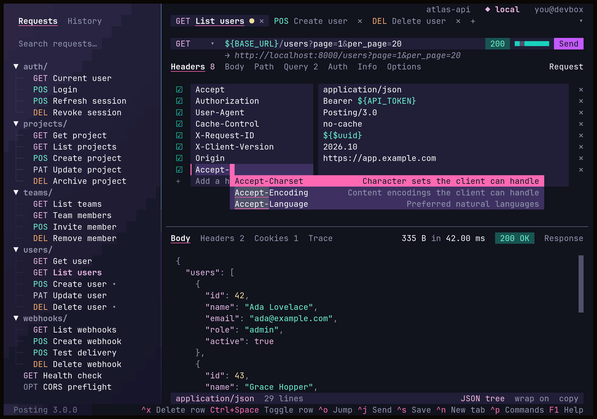
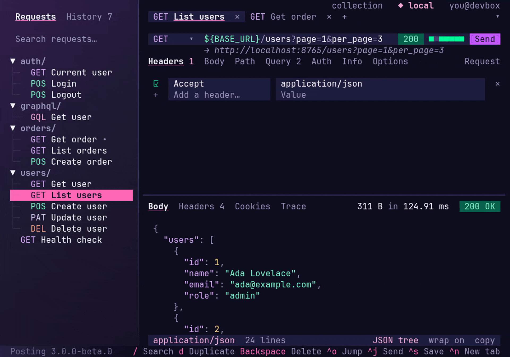
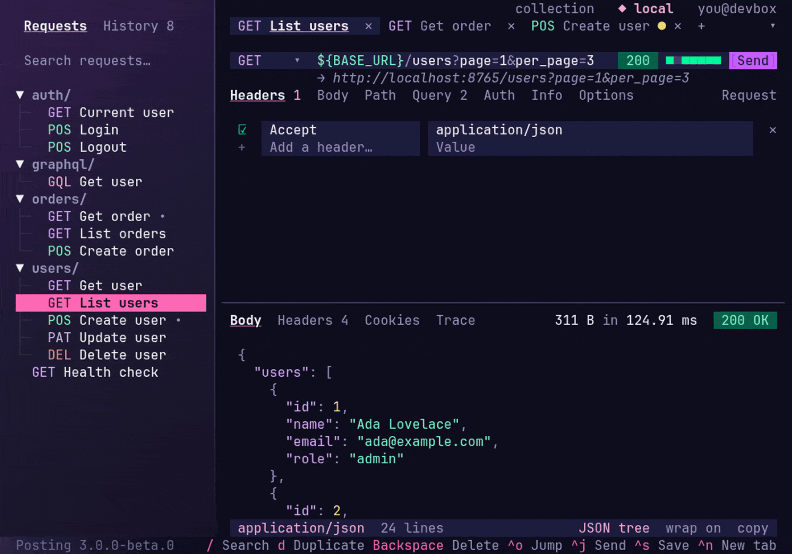
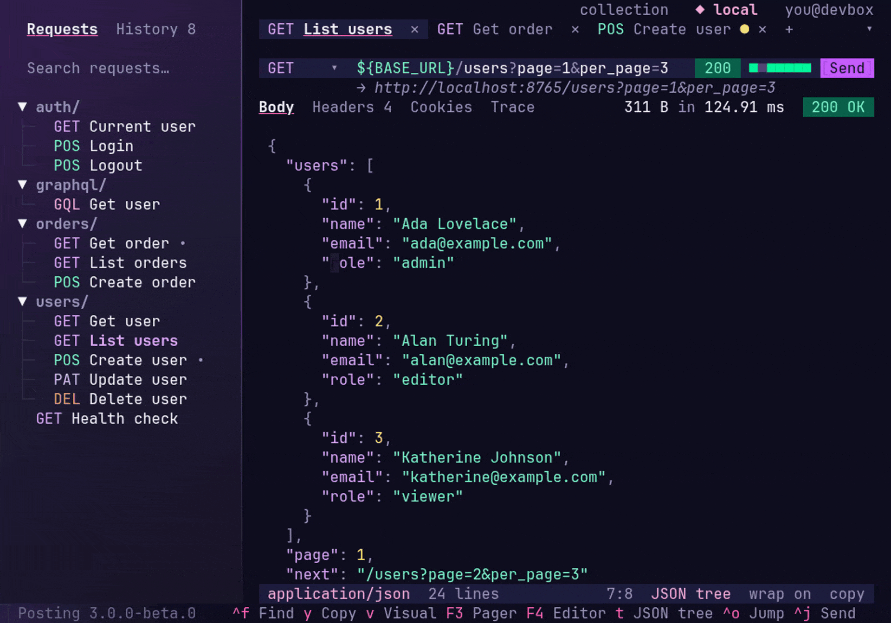
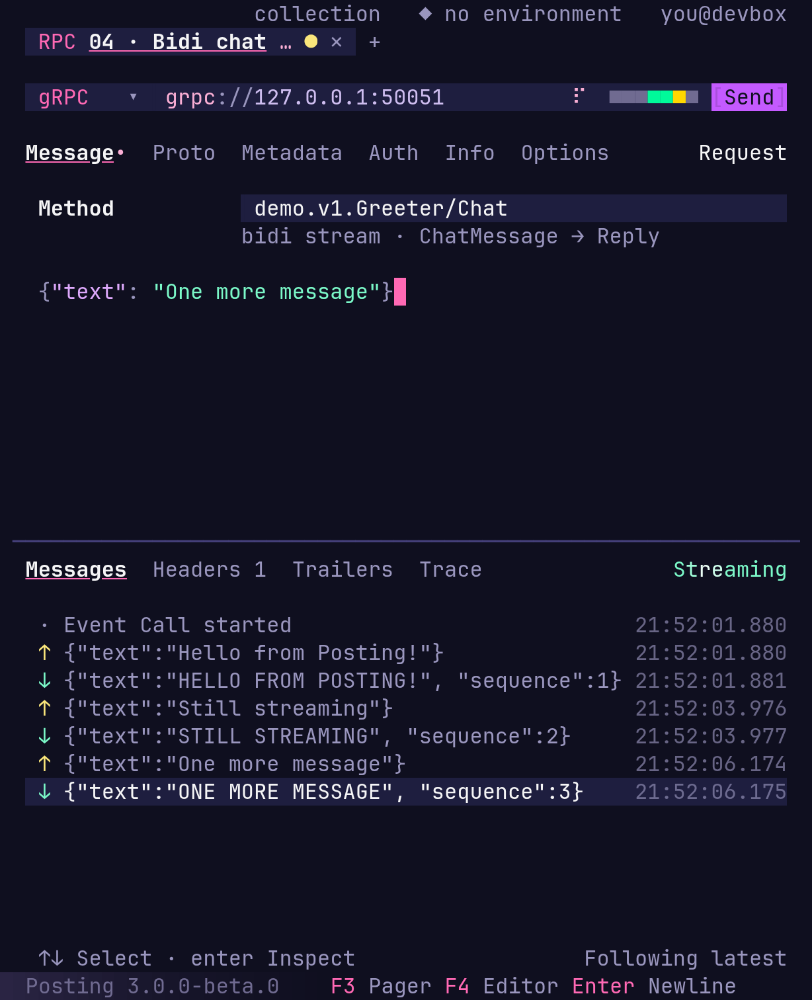
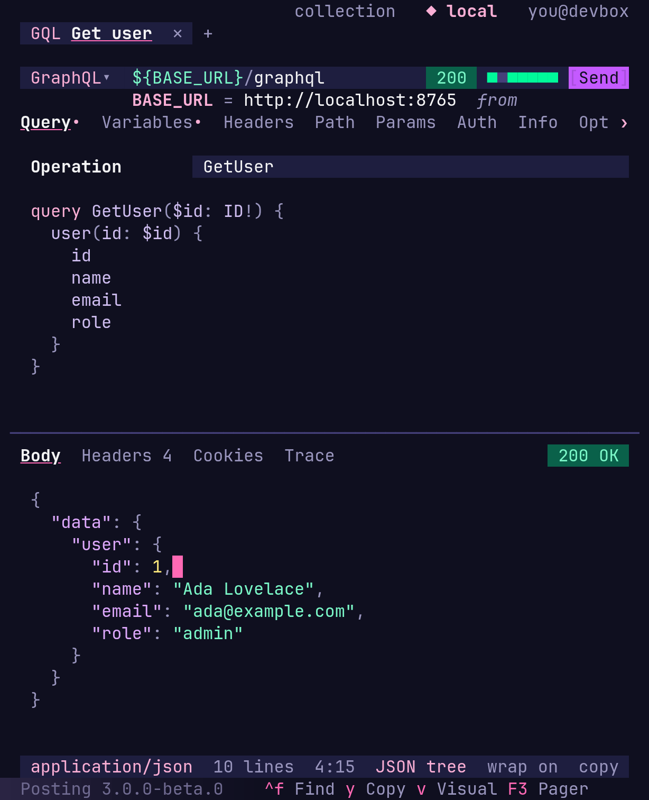

<h1 align="center">Posting</h1>

<p align="center"><strong>A powerful HTTP client that lives in your terminal.</strong></p>

<p align="center">Posting is an HTTP client, not unlike Postman and Insomnia. As a TUI application, it can be used over SSH and enables efficient keyboard-centric workflows. Your requests are stored locally in simple YAML files, so they're easy to read and version control.</p>



<p align="center"><a href="https://posting.sh">Website</a> · <a href="#installation">Installation</a> · <a href="https://posting.sh/guide/">User guide</a></p>

Some notable features include:

- request tabs, so you can work on several requests at once
- "jump mode" navigation
- layered environments and variables, with a variables screen and autocompletion
- header autocompletion and collection search
- syntax highlighting
- response search, a collapsible JSON tree, and JSONPath filtering
- HTTP, GraphQL, and gRPC, including streaming
- server-sent events (SSE), with a live event log and JSON payload inspection
- request timing, and a persistent history of responses
- customizable keybindings and extensive configuration
- 37 built-in themes, plus user-defined themes
- open in $EDITOR/$PAGER
- import curl commands by pasting them into the URL bar, and export requests as curl commands
- import from OpenAPI, Postman and Bruno
- a command palette for quickly accessing functionality
- `posting remote`, so coding agents like Claude Code and Codex can send requests through the Posting you have open while you watch

## Jump mode

Press a shortcut, type a label, and jump straight to any part of the interface.



## Mouse support

Click, scroll, select text, and drag to resize panels.



## Explore your responses

Search response text, explore JSON as a collapsible tree, and filter it with JSONPath.



## gRPC and GraphQL

Send GraphQL queries and work with gRPC services, including interactive streaming.

<table>
  <tr>
    <th>gRPC streaming</th>
    <th>GraphQL</th>
  </tr>
  <tr>
    <td width="50%"></td>
    <td width="50%"></td>
  </tr>
</table>

## Installation

Posting 3 is in beta. It's a single binary written in Go. Install it with Homebrew:

```bash
brew install darrenburns/homebrew/posting@beta
```

Or download an archive for macOS, Linux or Windows from the [releases page](https://github.com/darrenburns/posting/releases).
Or, with [Go](https://go.dev/dl/) 1.25.5 or newer installed, run:

```bash
go install github.com/darrenburns/posting/v3/cmd/posting@latest
```

Now you can run Posting via the command line:

```bash
posting
```

Coming from Posting 2? Posting 3 reads the same collections, configuration and `.env` files.
See [Coming from Posting 2](https://posting.sh/guide/migrating/) for what's changed.

## Contributing

Contributions are welcome! See [CONTRIBUTING.md](CONTRIBUTING.md) for guidelines. To build Posting 3 from a clone of this repository, run `go build ./cmd/posting`, and run the tests with `go test ./...`.

Try gRPC locally with the [example server and collection](examples/grpc/README.md), including an interactive bidirectional streaming walkthrough.

Posting 3 is built with [Terma](https://github.com/darrenburns/terma). Posting 2 was built with [Textual](https://github.com/textualize/textual).

<p align="center"><a href="https://posting.sh">Website</a> · <a href="#installation">Installation</a> · <a href="https://posting.sh/guide/">User guide</a></p>
